  

Software developer at **Softtech Solution and Services Co.** in Mati City, Philippines. I design, build, deploy, and maintain production systems — mostly PHP (CodeIgniter / Laravel) and MySQL — for schools, government offices, clinics, and organizations across Davao Region. The bulk of that work lives in private repositories.

**What I build — mostly private repos**

- **Student & school platforms** — student records systems, enrollment portals, and a multi-tenant LMS covering K-12, higher-ed, and tech-voc structures
- **Office & operations systems** — document submission & approval workflows, evaluation monitoring, technical assistance tracking, HRIS with performance reviews, an attendance portal, payroll, procurement
- **Business systems** — a resource planning suite (web, Android/iOS, macOS desktop), clinic management, a therapy management platform, MIS with medical module
- **Live event systems** — sports standings, campus journalism rankings, and pageant tabulation with public leaderboards
- **AI assessment platform** — React 19, Express 5, RAG-grounded question drafting, and Flutter OMR grading
- **Job platforms** — job-matching and hiring systems
- **Mobile** — Flutter companion apps for Android & iOS across records, attendance, therapy, and hiring
- **Dev tools** — a browser-based workbench: MySQL Workbench–style database browser, import/export, automated backups, API tester, QR generator, hash utilities, and a breadboard circuit simulator
- **Public apps** — [MeowBar](https://github.com/debugged-me/MeowBar) (macOS menu-bar monitor), [PaperTrail](https://github.com/debugged-me/PaperTrail) (receipt scanning), [Queueoke](https://github.com/debugged-me/Queueoke) (karaoke queue)

  

  

  <picture>
    <source media="(prefers-color-scheme: dark)" srcset="https://raw.githubusercontent.com/debugged-me/debugged-me/output/snake-dark.svg"/>
    
  </picture>

  

